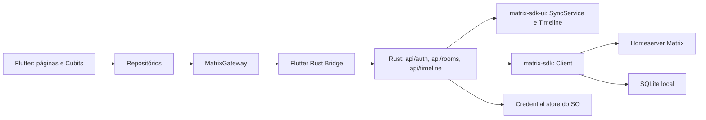

# Arquitetura

## Princípio central

O Flutter não acessa o protocolo Matrix diretamente. O Rust contém o
`matrix_sdk::Client`, persiste a sessão, mantém a sincronização e projeta os
dados do SDK em DTOs pequenos. Flutter trabalha somente com esses DTOs por meio
do Flutter Rust Bridge (FRB).



## Organização do código

```text
lib/
  app/                         composição da aplicação e tema
  bridge/
    generated/                 código FRB gerado, não editar
    matrix_gateway.dart        fachada Dart sobre a ponte
  core/models/                 modelos da aplicação
  features/
    auth/                      autenticação e estado da sessão
    rooms/                     lista de salas e timeline

rust/src/
  api/auth.rs                  cliente, sessão segura e SyncService
  api/rooms.rs                 projeção e stream de salas
  api/timeline.rs              projeção, stream e envio de texto
  api/health.rs                smoke test da ponte
  frb_generated.rs             código FRB gerado, não editar
```

## Fronteira Flutter–Rust

`MatrixGateway` é a única dependência de infraestrutura usada no Dart. Ele
traduz os tipos gerados pelo FRB em `SessionState`, `RoomSummary` e
`TimelineMessage`. `AuthRepository` e `RoomRepository` dependem dessa fachada;
widgets e cubits não importam arquivos em `bridge/generated`.

O contrato expõe comandos para inicializar autenticação, login, restauração,
logout e envio de texto. Os estados de autenticação, a lista de salas e a
timeline chegam ao Flutter como streams. Ao desmontar os cubits, as assinaturas
Dart são canceladas.

## Sessão e dados locais

No login, o Rust cria o `Client` com store SQLite no diretório privado informado
pelo Flutter e uma passphrase aleatória. O token de acesso, refresh token e a
passphrase ficam serializados no credential store do sistema operacional pela
crate `keyring`; a senha do usuário não é persistida.

Ao restaurar uma sessão, a aplicação lê esses dados, reabre o mesmo SQLite,
restaura o `MatrixSession` e inicia o `SyncService`. A atualização do token pelo
SDK regrava a sessão no credential store. No logout, a sincronização é parada,
o logout remoto é tentado e a credencial local é removida.

## Salas e timeline

`SyncService` mantém o cliente sincronizado. `watch_rooms` projeta as salas
já carregadas pelo cliente em `RoomSummary` e observa `rooms_stream` para
publicar novos snapshots. `watch_timeline` cria uma timeline de alto nível do
`matrix-sdk-ui`, envia o snapshot inicial e publica novos snapshots a cada
atualização. Apenas itens de mensagens de texto são convertidos para
`TimelineMessage`.

O envio chama a timeline do SDK com `RoomMessageEventContent::text_plain`. A
UI não implementa estados locais de `sending`, `sent` ou `failed`; essa é uma
limitação registrada para evolução posterior.

## Segurança e erros

Erros externos são classificados no Rust e chegam ao Flutter como códigos de
falha de autenticação. A tela mapeia esses códigos para mensagens em português,
sem exibir textos brutos do SDK. Tokens, passphrase do store e senha não são
enviados à UI, registrados em logs do projeto ou armazenados no Dart.

## Referências

- [Matrix Rust SDK](https://matrix-org.github.io/matrix-rust-sdk/matrix_sdk/index.html)
- [Matrix SDK UI — SyncService](https://matrix-org.github.io/matrix-rust-sdk/matrix_sdk_ui/sync_service/index.html)
- [Matrix SDK UI — Timeline](https://matrix-org.github.io/matrix-rust-sdk/matrix_sdk_ui/timeline/index.html)
- [Flutter Rust Bridge](https://cjycode.com/flutter_rust_bridge/)
