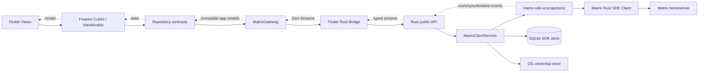

# Arquitetura

## Objetivo

Entregar um cliente Matrix desktop pequeno, testável e evolutivo, respeitando a
restrição central do desafio: toda interação com o protocolo Matrix acontece no
lado Rust por meio do Matrix Rust SDK. Flutter conhece apenas contratos próprios
da aplicação e nunca importa conceitos internos do SDK.

A arquitetura privilegia um fluxo vertical funcional em vez de uma divisão
excessiva em camadas. O domínio inicial é simples; use cases só devem surgir
quando houver orquestração reutilizada ou complexa.

## Visão geral



## Responsabilidades

### Flutter — presentation

- Renderizar as telas e componentes.
- Manter estado de interface por feature.
- Validar campos no nível de experiência do usuário.
- Mapear comandos do usuário para contratos de repository.
- Assinar streams e cancelar assinaturas no ciclo de vida correto.
- **Não deve interpretar eventos Matrix brutos nem implementar sincronização.**

Estrutura:

```text
lib/
  app/
    app.dart
    app_dependencies.dart
    app_session.dart
  core/
    errors/
    models/
  bridge/
    generated/          # somente código gerado pelo FRB
    matrix_gateway.dart # facade sobre o código gerado
  features/
    auth/
      data/
      presentation/
    rooms/
      data/
      presentation/
    timeline/
      data/
      presentation/
```

O código gerado pelo Flutter Rust Bridge permanece isolado em `bridge/generated`.
Widgets, Cubits e repositories dependem de `MatrixGateway`, nunca diretamente das
classes geradas.

### Rust — protocolo e estado Matrix

- Construir e possuir uma única instância de `matrix_sdk::Client` por sessão.
- Autenticar, restaurar sessão e encerrar a sessão.
- Configurar o armazenamento persistente usado pelo SDK.
- Iniciar, observar e encerrar as tarefas de sincronização.
- Projetar salas e eventos em DTOs pequenos e estáveis para Flutter.
- Enviar mensagens e propagar seu estado local/remoto.
- Traduzir erros do SDK para uma taxonomia controlada da aplicação.

Estrutura:

```text
rust/
  Cargo.toml
  src/
    api/                 # contrato público consumido pelo FRB
      auth.rs
      rooms.rs
      timeline.rs
    client/
      service.rs         # dono do Client e das tarefas
      session.rs
      sync.rs
    mapping/             # SDK/Ruma -> DTOs da aplicação
    model/               # DTOs e erros expostos na ponte
    storage/
      paths.rs
      secrets.rs
    lib.rs
```

## Contrato Flutter <–> Rust

### Comandos assíncronos

Superfície inicial, expressa conceitualmente:

| Operação | Entrada | Saída |
| --- | --- | --- |
| `initialize` | diretório da aplicação | estado inicial da sessão |
| `login` | homeserver, ID e senha | resumo da sessão |
| `restoreSession` | nenhuma | sessão restaurada ou ausência de sessão |
| `logout` | nenhuma | conclusão |
| `openRoom` | `roomId` | snapshot inicial da timeline |
| `sendTextMessage` | `roomId`, texto e transaction ID | identificador local |
| `closeRoom` | `roomId` | conclusão |

### Streams tipados

| Stream | Conteúdo |
| --- | --- |
| `watchSession` | autenticando, autenticado, encerrando, desconectado, erro |
| `watchSyncStatus` | iniciando, sincronizado, reconectando, erro recuperável |
| `watchRooms` | snapshot/deltas de salas já ordenadas para apresentação |
| `watchTimeline(roomId)` | snapshot/deltas e estado de envio das mensagens |

O Flutter Rust Bridge converte structs e enums traduzíveis em
objetos Dart normais e suporta streams Rust → Dart; isso permite uma API reativa
sem callbacks Dart armazenados no Rust.

## Fluxos principais

### Inicialização e restauração

1. Flutter inicializa o bridge e fornece o diretório privado da aplicação.
2. Rust procura metadados de sessão no armazenamento seguro.
3. Se não houver sessão, emite `disconnected`.
4. Se houver, constrói o `Client` com o mesmo SQLite store usado no login.
5. Rust restaura a sessão, inicia a sincronização e emite o snapshot de salas.
6. Flutter troca a raiz da aplicação de login para conversas.

É necessário reutilizar o mesmo store persistente. Caso contrário, o cliente restaurado não terá acesso ao estado das salas e às chaves de criptografia armazenadas anteriormente.

### Login

1. Flutter valida formato e presença dos campos (validação em UI).
2. Rust normaliza/descobre o homeserver e constrói o `Client` persistente.
3. Rust autentica com `matrix_auth().login_username(...)`.
4. Rust persiste apenas os dados necessários à restauração.
5. Rust executa a sincronização inicial.
6. O stream de sessão libera a navegação para a lista de salas.

**Senha nunca é persistida e nunca deve aparecer em logs.**

### Seleção de sala e timeline

1. Flutter envia `openRoom(roomId)`.
2. Rust cria ou reutiliza uma timeline de alto nível.
3. O snapshot inicial é enviado antes dos deltas subsequentes.
4. Trocar de sala cancela a assinatura anterior no Flutter e libera o recurso no
   Rust quando não houver consumidores.

### Envio de mensagem

1. Flutter gera um identificador local e envia texto normalizado.
2. Rust valida sessão e sala.
3. A mensagem entra na send queue/timeline como item local.
4. Flutter apresenta imediatamente o estado `sending`.
5. A timeline atualiza para `sent` ou `failed`, permitindo nova tentativa.

## Sincronização e concorrência

- Existe somente uma tarefa principal de sincronização por cliente.
- O `MatrixClientService` é o único dono das tasks e de seus tokens de
  cancelamento.
- O logout cancela streams/tasks antes de remover segredos e store.
- Reentrada de login enquanto já autenticado retorna erro controlado.
- Deltas carregam identificadores estáveis para atualização incremental no Dart.
- Backpressure deve ser tratado no Rust com snapshots compactados quando a UI não
  acompanhar a taxa de eventos; a ponte não deve transportar eventos Matrix crus.

## Erros

O Rust converte falhas externas para os tipos de erros abaixo, de modo a serem tratados pela aplicação Flutter corretamente:

- `invalidCredentials`
- `invalidHomeserver`
- `networkUnavailable`
- `rateLimited(retryAfter)`
- `sessionExpired`
- `storageUnavailable`
- `roomUnavailable`
- `messageRejected`
- `unexpected(correlationId)`

Mensagens exibidas ao usuário são definidas no Flutter. Detalhes técnicos ficam
em logs estruturados sem tokens, senhas ou conteúdo sensível.

## Referências

- [Matrix Rust SDK — visão geral](https://matrix-org.github.io/matrix-rust-sdk/matrix_sdk/index.html)
- [Matrix Rust SDK UI — RoomListService](https://matrix-org.github.io/matrix-rust-sdk/matrix_sdk_ui/room_list_service/index.html)
- [Matrix Rust SDK UI — Timeline](https://matrix-org.github.io/matrix-rust-sdk/matrix_sdk_ui/timeline/index.html)
- [Restauração de sessão](https://matrix-org.github.io/matrix-rust-sdk/matrix_sdk/authentication/matrix/struct.MatrixAuth.html)
- [Flutter Rust Bridge — tipos](https://cjycode.com/flutter_rust_bridge/guides/types/overview)
- [Flutter Rust Bridge — streams](https://cjycode.com/flutter_rust_bridge/guides/types/translatable/stream)
- [Flutter — guia de arquitetura](https://docs.flutter.dev/app-architecture/guide)
